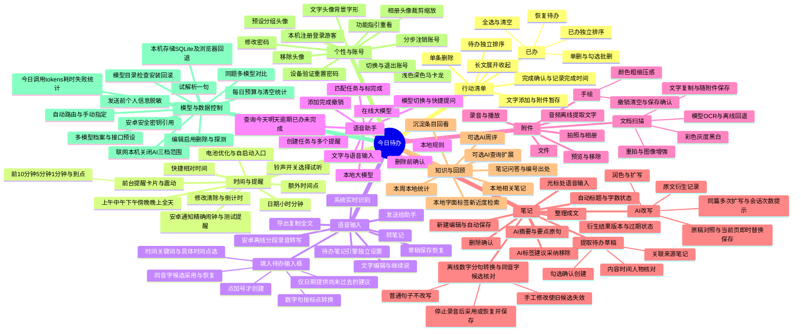

# 今日待办：现有功能与调用路径

核实范围：2026-10-27 复核的工作副本 `assets/index.html`、`assets/js/app.js`、实际加载的 `assets/js/ai`、`domain`、`data`、原生桥接，以及10-26调查 APK 的 `native-investigation/VoiceEngine.java` 反编译证据。下图是功能 mindmap；后面的路径表补足调用关系（mindmap 的缩进表示功能归属，不表示执行顺序）。只有桥接代码时，不把方法存在等同于权限已开启或设备必然支持；前端新增逻辑以工作副本为准，不声称已在手机安装验证。

## 可追溯调用路径

下表的未带文件名前缀函数均在 `assets/js/app.js`；入口 ID 在 `assets/index.html`。箭头表示关键调用链，省略通用 DOM 创建与显示隐藏代码。原生调用经 `assets/js/native.js` 的 `TodoNative` 适配到 `AndroidHost`，浏览器路径按能力检查回退。

| 功能 / 可见入口 | 关键调用路径 | 数据或设备模块 |
| --- | --- | --- |
| 待办/已办/笔记 `tab-todos/tab-archive/tab-memos` | `bindTodoEvents/bindMemoEvents → switchPanel → renderList/renderArchive/renderMemoList` | `state.todos`、`MemoService` |
| 文字加任务 `form-add` | submit → `addTodo → saveTodos → renderList → syncNative` | `SqlRepo` 可用时写 SQLite，否则 `AppStorage`；`TodoNative.sync` |
| 长内容点击 | `createItemElement` 的文字 click → 切换 `is-expanded` | 只改变展示 |
| 完成勾选 | `toggleTodo → askConfirm → setDone → saveTodos` | 写入 `completedAt`；助手完成走 `asstComplete → setDone`，不重复清单确认窗 |
| 单删任务 | `createItemElement → deleteTodo → saveTodos` | 删除任务；不能称为回收站 |
| 已办恢复、选择、删除 | `undoArchiveItem / setArchiveSelected / toggleArchiveAll → deleteSelectedArchive / clearArchive → askConfirm → removeTodosByIds` | `saveTodos`、原生提醒同步 |
| 清除已完成 `clear-done` | `clearCompleted → askConfirm → removeTodosByIds` | 同一任务表 |
| 两组排序 `sort-btn-active/archive` | `openSortSheet → applySort → renderList/renderArchive` | 用户排序偏好 |
| 新增/任务时间按钮 | `openTimePopover → pickTimeOption/useTimePreset → confirmTimePopover → applyPickedTime → setAddTime/setDueAt` | `saveTodos`；时段 `fuzzySlot` 与 `dueFuzzy` |
| 时间清除 | `time-clear → resetAddTime` 或任务时间 × → `setDueAt(id,null)` | 原生计划重新同步 |
| 倒计时及前台提醒 | `startTicking → tick → updateCountdowns/checkReminders → showReminder → startRing` | `nativeRing/webChime`、震动；关闭卡片 `dismiss → stopRing` |
| 安卓后台提醒 | `saveTodos/syncNative → TodoNative.sync`；恢复 `__onNativeResume → catchUpReminders` | `native.js` 过滤未完成有时间任务后交 `AndroidHost`；含 `extraTimes` |
| 通知/精确闹钟提示与测试 | `native.js` 权限状态渲染与动作分派 | `requestNotifications / openExactAlarmSettings / testNotification` 原生适配，按设备支持显示 |
| 铃声设置 | `toggleRing / openRingSheet → renderRingList → chooseRingtone` | `nativeRingApi` 系统铃声枚举、试听、保存 |
| 电池、自启 | `battery-btn/autostart-btn → TodoNative` | `syncBatteryRow/syncAutoStartRow` 及系统设置跳转 |
| 待办麦克风 `voice-btn` | `startVoiceInput → startDictationFlow/openVoiceLayer/startWebSpeech` | 原生语音或 Web Speech；按设置与能力分流 |
| 录音转写 `voice-dictate` | `toggleDictationMode → startDictationFlow → pumpDictation → absorbDictationText → maybeFinishDictation` | 优先本地；本地不可用/挂起且配置了服务时可走 `llmUploadAudio`；含超时和取消 |
| APK 本地语音引擎 | `native-investigation/VoiceEngine.java: ensure → transcribe → llmCorrect` | Sherpa ONNX Zipformer transducer；encoder/decoder/joiner、同音替换与标点模型；尝试本机/局域网 qwen3:8b 纠错。`tryCorrect` 方法未完整反编译，不能据此确认其全部传输细节 |
| 语音编辑/继续/退出 | `renderVoiceText / resumeVoiceListening / cancelVoice` | `saveVoiceDraft/loadVoiceDraft`；退出保存未发送草稿 |
| 语音存笔记/待办 | `voice-to-memo → saveVoiceAsMemo`；`voice-to-todo → sendVoiceToTodoInput` | 前者保存笔记；后者填输入框，仍需 `form-add` 提交 |
| 语音导出 | `voice-export → copyTextToClipboard(voiceTextNow())` | 剪贴板 API / `execCommand`；没有生成导出文件 |
| 发助手/助手文字 | `sendVoiceText/asstSubmit → asstTurn → asstThink` | `asstApplyLocal/asstAskModel/asstAskOllama` |
| 助手本地理解 | `parseLocalIntent → parseTimeExpr/asstSlotOf → asstApply` | `asstCreate/asstQuery/asstComplete/asstDeletePrompt` |
| 助手删除/撤销 | `asstResolvePending → asstDelete`；`asstUndo` | 创建和完成带可撤销回执；删除必须确认 |
| 助手模型切换 | `assistant-model → asstCycleModel → renderAsstModel` | 可用模型列表及本地引擎 |
| 附件来源 `draw-btn` | `openAttachSource → dispatchAttachSource` | `editingAttachments` 随下次创建入库 |
| 手绘 | `openDrawPad → beginStroke/moveStroke/endStroke → undoStroke/finishDrawPad` | Canvas PNG、压感、6色/3粗细；离开 `closeDrawPad` 确认 |
| 拍照/相册/文件 | `dispatchAttachSource → pickAttachmentFile/fileToAttachment → addAttachment` | 原生附件入口或文件选择能力 |
| 录音附件 | `startAudioRecord → stopAudioRecord → addAttachment` | WebView/浏览器统一 `getUserMedia + MediaRecorder`，60秒自动停 |
| 扫描文档 | `startScanFlow → TodoNative`；`ScanHost.captured → setScanMode → processScan → ScanHost.processed` | 彩色/灰度/黑白；原生拍摄和扫描处理 |
| 扫描 OCR | `runScanOcr → runScanOcrByLlm` 或 `runScanOcrNative → ScanHost.ocrDone → applyScanOcrText` | `AiGateway` 视觉请求，失败回离线；`scanNow` 保存文字与图像 |
| 附件预览与移除 | `openAttachmentPreview / removeAttachment` | 图片、录音等按类型展示，已有 OCR 文本可复制 |
| 录音离线提字 | `runAttachmentStt → floatPcmToWavBase64 → TodoNative.whisperTranscribeWav → AttStt.done` | OfflineAudioContext 重采样；文本写回附件 |
| 新建编辑笔记 `memo-new` | `openMemoSheet → scheduleMemoSave → memoSaveNow` | `domain/memo.js: MemoService`；自动标题、版本与字数 |
| 删除笔记 `memo-delete` | `deleteMemo → askConfirm → MemoService.remove → DerivedStore.drop` | 笔记软删除并清理索引、衍生记录；界面不提供恢复入口 |
| 笔记语音 `memo-voice` | `memoVoiceToggle → armMemoVoiceSegment/memoVoiceStartWeb` 或 `memoDictStart → memoDictPump` | `memoVoicePaintText` 光标处插入、原生/浏览器识别 |
| 笔记离线数字核对 | `memoDictCommit → spokenDigitCandidate → spokenNumericClause → paintMemoDigits → adoptMemoDigits` | 按标点拆分独立数字句；普通句子保留；停止录音后采用同音字候选并保存，可恢复；手工修改失效 |
| 待办时间建议 `add-time-suggestions` | `sendVoiceToTodoInput/input → refreshAddTimeSuggestions → parseTimeExpr → setAddTime → addTodo` | 手工输入也触发；关键词与具体时间并列，点选设置提醒，再点加号创建；仅日期给9/14/20点中未过时的建议，可自选/关闭，多个候选不是批量提醒 |
| 待办语音数字核对 `add-digit-fix` | `sendVoiceToTodoInput → prepareAddVoiceDigits → spokenDigitCandidate → spokenNumericClause → adoptAddDigits` | 按标点拆分数字与普通句子；候选采用/恢复不改变已选提醒或相对时间基准 |
| 摘要/整理/抽待办 | `runMemoTask(summarize/structVoice/extractTodos) → AiTaskRegistry.run` | `ai/tasks.js` 提示词、schema验证和一次修复；`DerivedStore` 保存指纹 |
| 整理成文结果 | `applyStructuredMemo` | 标题正文落笔记；待办交 `openDraftSheet` |
| 草稿确认 `draft-confirm` | `openDraftSheet → parseLocalIntent → selectedDrafts → confirmDraft → addTodo` | `domain/links.js: LinkService` 来源关联；不双向同步正文 |
| AI 标签 | `runMemoTask(tags) → renderMemoTags → adoptMemoTag/removeMemoTag` | `DerivedStore` 存建议及已采纳状态 |
| 润色/扩写 | `showRwModes → runMemoRewrite → showRewriteCard → adoptRewrite → memoSaveNow` | `AiTaskRegistry(rewrite)`；同篇可多次扩写，显示会话次数；`DerivedStore` 先备份原稿，当前页即时替换保存；存储失败保留稿件重试 |
| AI 结果状态 | `renderMemoAi → memoFingerprint` | `domain/derived.js` 记录 memoRev/modelId/promptVer/schemaVer；旧结果标过期 |
| 相关笔记 | `renderMemoRelated → LinkService.related → openMemoSheet` | `domain/links.js` 本地索引词与采纳标签 |
| 笔记搜索 `memo-search` | `renderMemoList → SearchService.hybrid → paintMemoList` | `domain/search.js` 字面/标签/新近度，`indexer.js` 索引；可选 `searchExpand` |
| 问一问 `memo-ask` | `openQaSheet → qaAskNow → 检索片段 → AiTaskRegistry.run(qa)` | 回答编号来源 click → `openMemoSheet` |
| 周回顾 `memo-review` | `openReviewSheet → renderReview → StatsService`；`runReviewAi` 可选 | `domain/stats.js` 本周统计；`sedimentNode` 跳笔记 |
| 主题 `theme-pick` | `applyThemeMode → savePrefs → syncThemePicker` | `html[data-theme]` 浅色/深色/马卡龙 |
| 头像 | `openAvatarSheet → buildAvatarCell/applyAvatar`；`pickAvatarFromGallery → openCropper → confirmCrop` | `avatars.js`、Canvas 裁剪；拖动缩放 |
| 文字头像 | `openTextAvatar → renderTextAvatar → confirmTextAvatar` | 背景类型/色与 `artFontFamily` 字体选择 |
| 本机注册登录 | `bindAuthEvents → Auth.register/login → enterApp`；`loginAsGuest` | `auth.js` 本机盐和口令派生；`storage.js` 会话存储，无服务端账号同步 |
| 切换/退出 | `switchAccount`；`logout-btn → Auth.logout` | 用户数据按本地账号隔离 |
| 改密、找回、注销 | `openAuthSheet → submitChangeForm/verifyForReset/submitResetForm/doDeleteAccount` | `AuthHost.result` 接设备验证回调；`auth.js` 管理本地凭证 |
| 设置三个语音入口 | `bindModePick → syncVoiceModePicks/syncVoiceEnginePick → savePrefs` | 待办/笔记识别与助手推理独立配置 |
| 模型档案 | `openModelSheet → readModelForm → saveModelForm`；`useModel/deleteModel/probeModelCard` | 接口预设、能力编辑、模型探测、密钥引用 |
| 路由与试解析 | `pickModel → taskScore`；`llm-status-refresh → runTask` | 自动/手动路由，能力和任务权重 |
| 多模型对比 | `openCompare → runCompare → runTask → updateCompareCard` | 同题任务及模型选择、耗时、质量说明 |
| 模型目录 | `checkModelCatalog → installCatalogUpdate → rollbackCatalog` | 只更新可选模型目录，不覆盖用户档案 |
| AI传输与门禁 | `registerAiTransport → AiTaskRegistry → runMessages → AiGateway.run` | `ai/gateway.js` 超时重试；`ai/consent.js` 发送前范围检查；`ai/safety.js` 脱敏。该门禁不能等同于独立原生语音/音频上传路径的全局断网保证 |
| 用量预算 | `renderAiUsage/cycleAiBudget/clearAiUsage` | `ai/usage.js` 调用/tokens/耗时/失败、每日上限；统计为本机估计，非账单 |
| 密钥 | `storeSecret/secureKeys/keyStorageMode` | `keyvault.js` 原生安全存储；网页回退状态会明确显示 |
| 初始化与迁移 | `boot → Migrator / migrateLocalToSqlite` | `data/db.js`、`sqlrepo.js`、`migrate.js`；SQLite不可用则浏览器存储回退 |
| 功能指引 `guide-row` | `openGuide → renderGuide → GuideV2.render` | 10页40卡，跟随3主题；内容脚本不改宿主导航 |

## 能力边界

- 已核实的是文档扫描，不存在二维码/条码扫描导入入口；对 `assets` 搜索“扫码/二维码/scanCode”无命中。不能把扫描宣传为扫码导入。
- 未发现云同步、跨设备账号、协作分享、系统日历同步、周期重复任务入口，均不列为既有能力。
- 离线转写、文档扫描、系统铃声、设备验证、后台提醒等依赖 Android 容器和设备权限。前端有入口与桥接不代表所有手机必然可用。
- 在线 AI 需要服务地址、模型、密钥和相应数据范围。OCR 的模型路径还需要服务支持图像输入。AI 摘要/扩写/问答等是辅助结果，不承诺事实正确。
- 本机大模型调用是独立支持路径，其实际服务是否安装和运行不属于前端可验证范围。
- 当前 APK 的声学识别为 Zipformer，并非旧目录源码或前端注释中的 SenseVoice/whisper。原生纠错会尝试本机及局域网服务；本地声学识别不等于整条语音链路不联网。只在本机/关闭AI的前端门禁不可宣传为设备全局断网开关。
- 数字规则只处理已识别文字中的独立数字句；金额、日期、小数、含普通词语句和短串等未必转换。普通句子不改写；动/沟/腰/有并非随处替换。手工编辑后旧候选失效，采用/恢复待办数字不会重算已选择的相对提醒基准。
- 声学漏字问题按用户要求暂缓处理，漏掉的数字需手动核对补全。前端自动化测试不能证明真机识别准确率，不能表述为“数字识别全过”。
- 保存失败会提示；文字已经显示不代表持久化成功。停止录音可能仍需等待剩余分段，关闭或切换笔记后的旧回调不应写入另一篇正文。

修订项及核对证据见[功能指引差异核对](功能指引差异核对.md)；操作路线见[功能使用指引](功能使用指引.md)。
